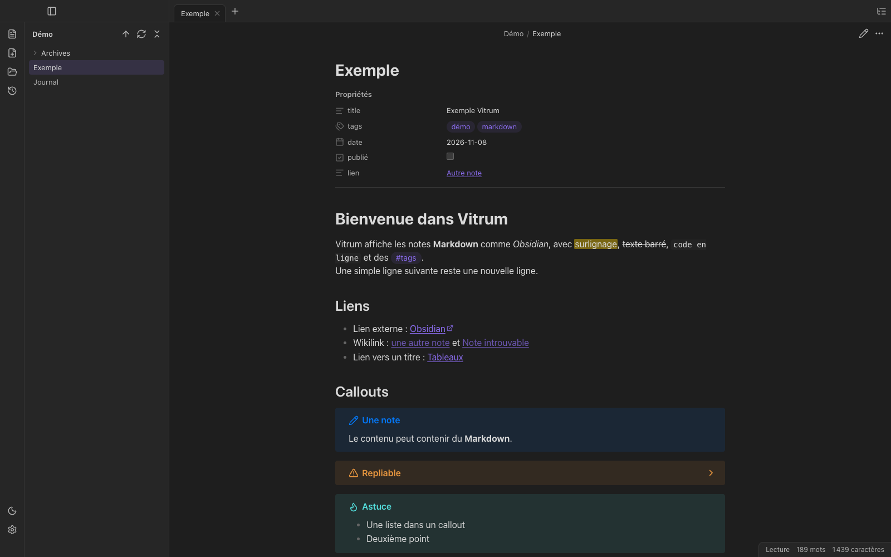

# Vitrum

**Lire et modifier ses notes Markdown où qu'elles soient, avec le confort d'Obsidian.** Windows et macOS.

Vitrum ouvre n'importe quel fichier `.md` du disque, sans coffre ni import : un double-clic sur la note suffit. Le mode lecture affiche la note comme Obsidian (propriétés, callouts, tâches, formules, diagrammes…), le mode édition montre le Markdown brut coloré et enregistre au fil de l'eau.

*Vitrum* : « verre » en latin, clin d'œil à l'obsidienne, un verre volcanique.

> Projet indépendant, sans lien avec Obsidian.



<!-- Liens permanents vers la dernière version : chaque publication doit joindre ces fichiers, avec ces noms exacts (Vitrum-Setup.exe, Vitrum-macOS.dmg). -->

## Télécharger

**Windows 10 et 11** (64 bits) :

- **[Télécharger l'installateur pour Windows](https://github.com/venaciteam/vitrum/releases/latest/download/Vitrum-Setup.exe)** : il s'installe sans droits administrateur, ajoute Vitrum au menu « Ouvrir avec » et propose d'en faire l'application par défaut des `.md`.

**Mac avec puce Apple** (M1 et plus récent, macOS 11 ou plus récent) :

- **[Télécharger Vitrum pour Mac](https://github.com/venaciteam/vitrum/releases/latest/download/Vitrum-macOS.dmg)** : ouvrir le `.dmg` et glisser Vitrum dans **Applications**.

Vitrum n'est pas signé : le message du système au premier lancement et les étapes sont dans [Installation](#installation). Toutes les versions : [publications](../../releases).

## Ce que fait Vitrum

- **Mode lecture** : rendu final comme dans Obsidian (propriétés du front matter, callouts repliables, tableaux, tâches cochables, `==surlignage==`, `#tags`, notes de bas de page, formules `$…$`, diagrammes Mermaid, code coloré, images locales et `![[intégrations]]`, commentaires `%%…%%` masqués).
- **Mode édition** : Markdown brut coloré (CodeMirror, comme Obsidian), enregistrement automatique après une seconde (désactivable). `Ctrl+E` bascule entre les deux modes en gardant sous les yeux le texte qu'on lisait.
- **Zoom du contenu** (la note, pas l'interface) : `Ctrl` + `+` / `-` / `0`, Ctrl + molette, pincement du trackpad ou du pavé tactile, menu « … » de l'onglet, et menu « Présentation » sur Mac. Le pourcentage est retenu et s'affiche dans la barre d'état.
- **Dossiers favoris** : clic droit sur un dossier du panneau de fichiers, « Ajouter aux favoris ». Ils restent en haut du panneau d'un lancement à l'autre.
- Onglets, panneau des fichiers du dossier de la note, plan du document, recherche (`Ctrl+F`), thème clair ou sombre, glisser-déposer de fichiers sur la fenêtre.
- Un fichier modifié par une autre application est rechargé ; s'il a aussi des modifications non enregistrées, Vitrum demande quelle version garder.
- Les fins de ligne (CRLF ou LF) et le BOM UTF-8 d'origine sont conservés à l'enregistrement.
- Les liens entre notes ne sont pas un objectif, mais un `[[wikilink]]` s'ouvre quand la note est trouvée (à côté du fichier, ou dans le coffre Obsidian s'il y en a un au-dessus).

## Raccourcis

| Action | Windows | macOS |
| --- | --- | --- |
| Basculer lecture / édition | `Ctrl+E` | `⌘E` |
| Ouvrir un fichier | `Ctrl+O` | `⌘O` |
| Nouveau fichier | `Ctrl+N` | `⌘N` |
| Enregistrer tout de suite | `Ctrl+S` | `⌘S` |
| Rechercher dans la note | `Ctrl+F` | `⌘F` |
| Nouvel onglet / fermer l'onglet | `Ctrl+T` / `Ctrl+W` | `⌘T` / `⌘W` |
| Onglet suivant / précédent | `Ctrl+Tab` / `Ctrl+Maj+Tab` | idem |
| Rouvrir le dernier onglet fermé | `Ctrl+Maj+T` | `⌘⇧T` |
| Paramètres | `Ctrl+,` | `⌘,` |
| Zoom avant / arrière / 100 % | `Ctrl` + `+` / `-` / `0`, ou Ctrl + molette | `⌘` + `+` / `-` / `0`, ou pincement |

Dans la vue de lecture, `Ctrl+clic` (ou clic molette) ouvre un lien dans un nouvel onglet.

## Installation

### Windows

1. Télécharger [`Vitrum-Setup.exe`](https://github.com/venaciteam/vitrum/releases/latest/download/Vitrum-Setup.exe) et le lancer : il s'installe pour l'utilisateur courant, sans droits administrateur.
2. À la fin, il propose d'ouvrir les `.md` avec Vitrum par défaut. Windows ne laisse aucun programme se déclarer par défaut tout seul : il ouvre donc la page des Paramètres consacrée à Vitrum, où il reste à cliquer sur `.md` puis sur Vitrum. Le même bouton existe dans les paramètres de Vitrum.

> [!NOTE]
> Vitrum n'est pas signé numériquement. Windows peut afficher « Windows a protégé votre ordinateur » : cliquer sur « Informations complémentaires », puis « Exécuter quand même ».

### Mac

1. Télécharger [`Vitrum-macOS.dmg`](https://github.com/venaciteam/vitrum/releases/latest/download/Vitrum-macOS.dmg), l'ouvrir et glisser Vitrum dans **Applications**.
2. Au premier lancement, macOS bloque Vitrum, qui n'a pas d'identité de développeur Apple :
   - **macOS 15 (Sequoia) et suivants** : ouvrir Vitrum une fois (macOS refuse, cliquer sur **Terminé**), puis **Réglages Système** › **Confidentialité et sécurité** › tout en bas, **Ouvrir quand même**, et confirmer.
   - **macOS 14 (Sonoma) ou plus ancien** : clic droit sur Vitrum › **Ouvrir**, puis **Ouvrir** dans l'avertissement.
   - Dans tous les cas, le Terminal fait la même chose : `xattr -dr com.apple.quarantine /Applications/Vitrum.app`

   Ensuite Vitrum s'ouvre normalement.
3. Pour en faire l'application par défaut des `.md` : clic droit sur un `.md` › **Lire les informations** › **Ouvrir avec** : Vitrum › **Tout modifier…**

## Mises à jour

Depuis la version 0.3.0, Vitrum vérifie lui-même s'il existe une nouvelle version (au lancement, puis toutes les six heures). Quand c'est le cas, une carte apparaît en bas à droite : « Nouveautés » ouvre la page de la version, « Installer et redémarrer » enregistre vos notes, télécharge la mise à jour, vérifie sa signature, l'installe et relance Vitrum. Rien ne s'installe sans votre accord.

Dans les Paramètres, « Mises à jour » permet de couper la vérification automatique ou de vérifier tout de suite. Sur Mac, le menu **Vitrum** › **Rechercher les mises à jour…** fait de même.

Avant la 0.3.0 : télécharger la nouvelle version et l'installer par-dessus l'ancienne (sur Mac, remplacer Vitrum dans **Applications**). Les réglages, les favoris et les onglets ouverts sont conservés.

## Désinstallation

- **Windows** : Paramètres › Applications › Vitrum › Désinstaller.
- **Mac** : glisser Vitrum depuis **Applications** dans la Corbeille.

Les notes ne sont jamais touchées : Vitrum ne fait que les ouvrir là où elles sont.

## Confidentialité

Vitrum ne collecte rien et n'envoie rien à son auteur. Il n'a pas de serveur, et ses polices, ses icônes et ses outils de rendu sont livrés avec lui. Il ne se connecte à Internet que pour afficher ce que contiennent vos notes (images en ligne, vidéos intégrées YouTube ou Vimeo) et pour chercher les mises à jour sur GitHub, ce qui se coupe dans les Paramètres. Les réglages restent sur votre ordinateur.

## Signaler un problème

Les bugs et les idées sont les bienvenus dans les [issues](../../issues) du dépôt (un compte GitHub est nécessaire, et une issue est publique). Indiquer la version de Vitrum (Paramètres) et le système, et, si possible, joindre une petite note qui reproduit le problème.

## Pour développer

Prérequis : [Rust](https://rustup.rs) et [Node.js](https://nodejs.org) 20 ou plus récent. Sur Mac, il faut aussi les outils en ligne de commande d'Xcode (`xcode-select --install`). Windows 11 fournit déjà WebView2.

```bash
npm install
npm run dev           # l'interface seule dans un navigateur, avec un faux cœur (pratique pour l'apparence)
npm run tauri dev     # l'application complète en développement
npm run tauri build   # version finale et installateur
cargo test            # dans src-tauri : tests du moteur Markdown
```

Résultat de `tauri build` : `src-tauri/target/release/bundle/nsis/Vitrum_X.Y.Z_x64-setup.exe` sous Windows, `src-tauri/target/release/bundle/dmg/Vitrum_X.Y.Z_aarch64.dmg` sur Mac.

Organisation du code :

| Dossier | Contenu |
| --- | --- |
| `src-tauri/` | le cœur en Rust (Tauri 2) : lecture et écriture des fichiers, rendu Markdown façon Obsidian (comrak et retouches de l'arbre), recherche des notes et images liées, surveillance des fichiers ouverts, protocole `vmedia` pour les médias locaux, instance unique, association des `.md` |
| `src-tauri/windows/hooks.nsh` | ajouts à l'installateur Windows (« Ouvrir avec », application par défaut) |
| `src/` | l'interface (TypeScript sans framework) : onglets, panneau des fichiers, plan, zoom, éditeur CodeMirror 6, Mermaid, KaTeX, highlight.js, icônes Lucide |
| `scripts/` | `publier.sh` (Mac) et `publier.ps1` (PC) fabriquent et publient une version, `latest-json.mjs` écrit le fichier des mises à jour, `version.mjs` change la version partout |
| `dev/` | note de démonstration, affichée par `npm run dev` |

### Publier une version

Tout se fabrique en local : chaque machine fabrique sa version et l'envoie elle-même dans la publication GitHub, le PC l'installateur Windows, le Mac le `.dmg`. Les deux fabriquent le même commit, `origin/main`, dans une copie propre sur le disque interne (`~/Library/Caches/venacity-build/vitrum` sur le Mac, `%LOCALAPPDATA%\venacity-build\vitrum` sur le PC). Il faut en plus [GitHub CLI](https://cli.github.com) connecté (`gh auth login`).

1. Changer la version partout d'un coup, commiter et pousser :

   ```bash
   node scripts/version.mjs X.Y.Z
   git commit -am "Version X.Y.Z" && git push
   ```

2. Essai sur chaque machine, sans rien envoyer : `scripts/publier.sh --essai` (Mac), `.\scripts\publier.ps1 -Essai` (PC). Plus simple : double-cliquer sur `Fabriquer Vitrum (Mac).command` ou `Fabriquer Vitrum (PC).cmd` à la racine du dépôt, qui demandent « 1 = essai » ou « 2 = envoyer sur GitHub », puis ouvrent le dossier du fichier produit.
3. Publication : `scripts/publier.sh` sur le Mac, `.\scripts\publier.ps1` sur le PC, dans n'importe quel ordre. Le premier crée la version en **brouillon** (notes avec `--notes notes.md` / `-Notes notes.md`) et y dépose son fichier ; le second y ajoute le sien et publie la version. Les liens de téléchargement ne changent donc qu'une fois les deux fichiers présents.

Les scripts s'arrêtent s'il reste des modifications non commitées, si `main` diffère de `origin/main`, si les numéros de version ne concordent pas, si les tests du cœur échouent, ou si la publication existante vise un autre commit.

Chaque machine envoie aussi son fichier de mise à jour signé : `Vitrum-Setup.exe.sig` pour le PC, `Vitrum-macOS.app.tar.gz` et sa `.sig` pour le Mac. La seconde machine écrit `latest.json` (`scripts/latest-json.mjs`) juste avant de publier : c'est ce fichier, à l'adresse `releases/latest/download/latest.json`, que lisent les copies installées.

### Clé de signature des mises à jour

Vitrum n'installe une mise à jour que si elle est signée par la clé dont la partie publique est dans `src-tauri/tauri.conf.json` (`plugins.updater.pubkey`). La partie privée ne doit jamais être sur GitHub ni en clair sur le disque :

- **PC** : chiffrée par Windows pour la session courante, dans `%LOCALAPPDATA%\venacity-build\cles\vitrum-maj.dpapi`. `publier.ps1` la lit.
- **Mac** : dans le trousseau, service `vitrum-maj`, compte `vitrum`. `publier.sh` la lit.
- **Copie de secours** : chiffrée par `age` avec une phrase secrète, hors du dépôt.

Perdre la clé ne casse rien, mais les copies déjà installées ne pourront plus se mettre à jour seules : il faudrait une nouvelle clé et une installation à la main. Sans clé, `--essai` / `-Essai` fabrique quand même, sans fichier de mise à jour.

## Licence

[MIT](LICENSE) © 2026 Venacity

Vitrum s'appuie sur [Tauri](https://tauri.app), [comrak](https://github.com/kivikakk/comrak), [CodeMirror](https://codemirror.net), [Mermaid](https://mermaid.js.org), [KaTeX](https://katex.org), [highlight.js](https://highlightjs.org) et [Lucide](https://lucide.dev), chacun sous sa propre licence libre.
