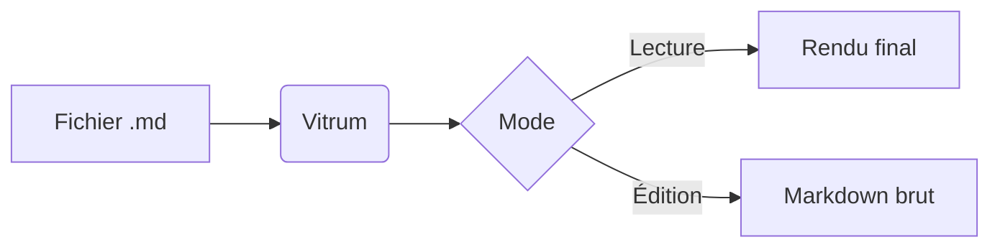

# Bienvenue dans Vitrum

Vitrum affiche les notes **Markdown** comme *Obsidian*, avec ==surlignage==, ~~texte barré~~, `code en ligne` et des #tags.
Une simple ligne suivante reste une nouvelle ligne.%% commentaire caché %%

## Liens

- Lien externe : [Obsidian](https://obsidian.md)
- Wikilink : [[Autre note|une autre note]] et [[Note introuvable]]
- Lien vers un titre : [[#Tableaux]]

## Callouts

> [!note] Une note
> Le contenu peut contenir du **Markdown**.

> [!warning]- Repliable
> Caché par défaut, cliquez sur le titre.

> [!tip] Astuce
> - Une liste dans un callout
> - Deuxième point

## Tâches

- [x] Écrire le moteur Markdown
- [ ] Tester sur le Mac
	- [ ] Sous-tâche
	- Simple puce imbriquée

## Tableaux

| Colonne | Alignée à droite | Centrée |
| :------ | ---------------: | :-----: |
| a       |                1 |    x    |
| b       |               22 |    y    |

## Code

```rust
fn main() {
    // Un commentaire
    let message = "Bonjour, Vitrum !";
    println!("{message} {}", 42);
}
```

## Diagramme



## Maths

L'énergie $E = mc^2$, et une formule centrée :

$$
\int_0^1 x^2\,dx = \frac{1}{3}
$$

## Citation et note

> Une citation classique, sur deux lignes
> avec un retour à la ligne.

Une phrase avec une note de bas de page[^1].

---

[^1]: Le texte de la note.
